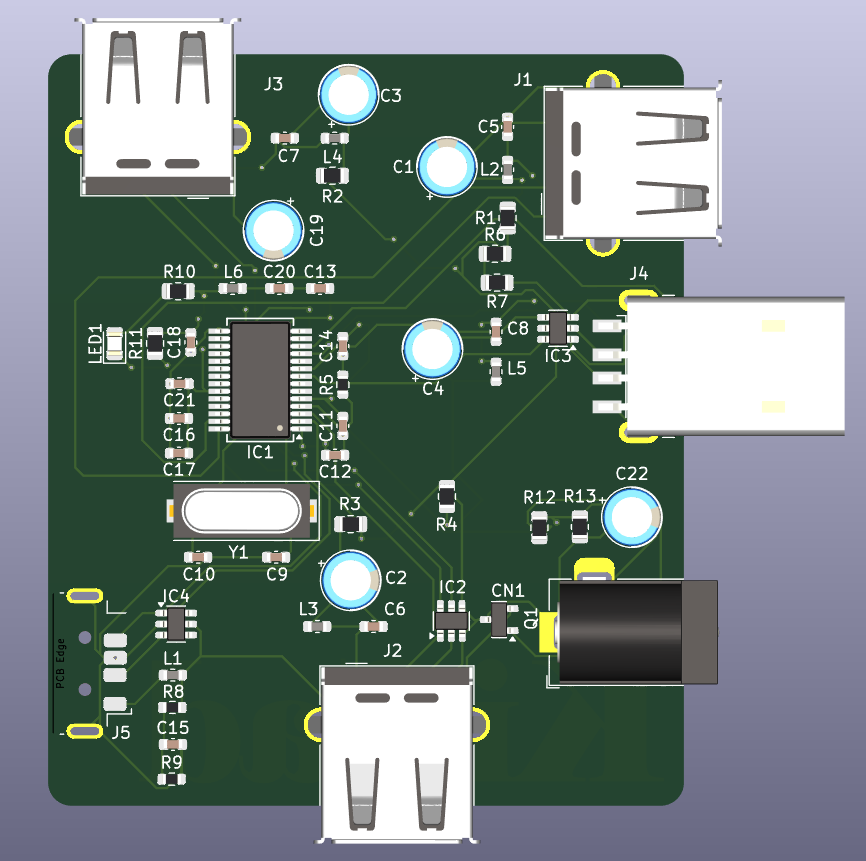
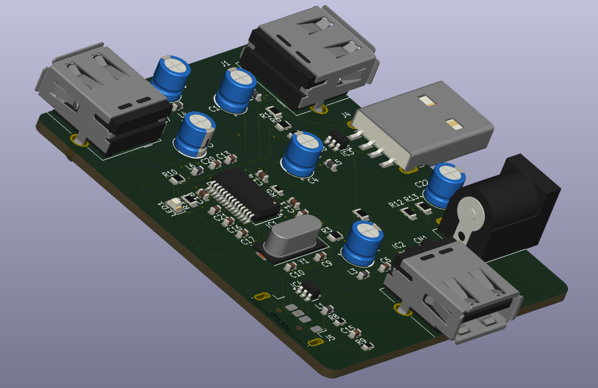
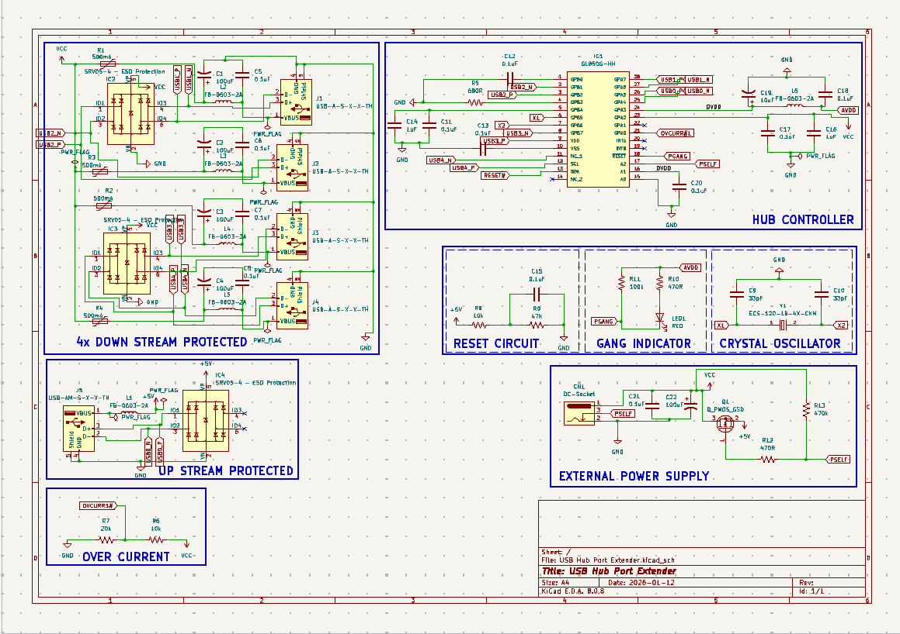

# 4-Port USB Hub (USB Hub Port Extender)

A KiCad 8 design for a self-powered 4-port USB hub board. The schematic names a Genesys Logic **GL850G** hub controller (`IC1`, value `GL850G-HH`), one upstream USB-A connector (`J5`), four downstream USB-A connectors (`J1`–`J4`), a DC barrel-jack power input (`CN1`), per-port polyfuses, ferrite beads and bulk capacitors, SRV05-4 ESD arrays, a 12 MHz crystal, and a gang-mode LED.

> **Status: design in progress — not ready for fabrication.**
> A source-level audit (see [docs/validation-report.md](docs/validation-report.md)) found several connectivity defects in the schematic and PCB, including a **net that ties USB port 2's D− line to the 5 V rail**, **swapped D+/D− on port 1**, an **unconnected reset input**, and a **hub-controller symbol that is actually a Microchip MCP23017 I/O-expander symbol**. No board has been fabricated or tested, no KiCad ERC/DRC has been run (KiCad was not available in the audit environment), and no USB compliance claim is made. Details in [Known issues](#known-issues).

## Contents
[Purpose](#purpose) · [Images](#project-images) · [Design summary](#design-summary) · [Specifications](#specifications) · [Opening the project](#opening-the-project) · [Libraries and models](#custom-libraries-and-3d-models) · [Validation status](#validation-status) · [Known issues](#known-issues) · [BOM](#bill-of-materials) · [Fabrication](#fabrication-workflow) · [Safety](#safety-and-limitations) · [Docs](#documentation) · [License](#license-and-attribution) · [Roadmap](#future-improvements) · [Contributing](#contributing)

## Purpose
A USB hub turns one host USB port into several. This project is a learning/portfolio hardware design that implements a hub on a custom 4-layer board using a single-chip hub controller, with an external 5 V barrel-jack supply so downstream ports are not powered solely from the host. See [docs/project-overview.md](docs/project-overview.md).

## Project images
All images are real KiCad screenshots of this design (taken 2026-01-22/23, i.e. intermediate states of the design, not a verified final revision). **There is no photograph of a fabricated or assembled board in this repository.**

| | |
|---|---|
|  |  |
| 3D viewer, top view: five USB-A connectors, DC jack, HC-49 crystal, SSOP-28 hub IC. | 3D viewer, perspective: through-hole radial bulk capacitors, mixed horizontal connector styles. |

*Single-sheet schematic (A4, dated 2026-01-12): downstream ports, hub controller, reset, gang indicator, crystal, upstream, overcurrent network and external power.*

### Gallery
| Image | Content |
|---|---|
| [pcb-layout-all-layers.png](docs/images/pcb-layout-all-layers.png) | PCB editor, all layers visible, board with zone fills |
| [pcb-layout-bottom-active.png](docs/images/pcb-layout-bottom-active.png) | PCB editor, back copper highlighted (large "KiCad" logo text is on `B.Cu`) |
| [schematic-downstream-and-controller.png](docs/images/schematic-downstream-and-controller.png) | Downstream ports J1–J4 with IC2/IC3 and hub controller IC1 |
| [schematic-upstream-and-overcurrent.png](docs/images/schematic-upstream-and-overcurrent.png) | Upstream J5/IC4 and the overcurrent divider (R6/R7) |
| [schematic-reset-gang-crystal-power.png](docs/images/schematic-reset-gang-crystal-power.png) | Reset network, gang LED, crystal, external power and Q1 |

## Design summary
* **Controller:** `IC1`, value `GL850G-HH`, 28-pin SSOP footprint. Genesys Logic is the manufacturer *implied by the value*; the official datasheet could not be retrieved during the audit, so the pin map is **not verified** (see D1 in [circuit-design](docs/circuit-design.md)).
* **Upstream:** `J5` (Type-A) → `IC4` SRV05-4 → hub pins 25/26 (`USB0_N`/`USB0_P`). Upstream VBUS passes through ferrite `L1` to net `+5V`.
* **Downstream:** `J1`–`J4` ↔ `USB1`–`USB4` pairs on hub pins 27/28, 2/3, 8/9, 11/12; ESD arrays `IC2` (ports 1–2) and `IC3` (ports 3–4). Each port has a 500 mA-labelled polyfuse (`R1`–`R4`), ferrite bead (`L2`–`L5`), 100 µF + 0.1 µF.
* **Power:** barrel jack `CN1` → rail `VCC`; `Q1` (P-MOSFET) links `+5V` (host VBUS) and `VCC`. Hub analog rail `AVDD` is `DVDD` through ferrite `L6`.
* **Clock:** `Y1` 12 MHz, 2×33 pF.
* **Board:** 55 mm × 65 mm, 4 copper layers (`F.Cu`, `In1.Cu`=GND zone, `In2.Cu`=`+5V` zone, `B.Cu`), 1.6 mm. 45 vias (0.6/0.3 mm), all tracks 0.2 mm.

## Specifications
Only values read from the design files are listed.

| Item | Value | Source |
|---|---|---|
| Hub controller (per value field) | GL850G-HH, SSOP-28 footprint | schematic/PCB |
| Downstream / upstream connectors | 4 / 1 USB Type-A | schematic |
| Crystal | 12 MHz, 18 pF load (library description), 2×33 pF | schematic + library |
| Port polyfuses | value labelled 500 mA (part unspecified) | schematic |
| ESD arrays | 3× SRV05-4 | schematic |
| Board size | 55 × 65 mm | PCB Edge.Cuts |
| Layers / thickness | 4 / 1.6 mm (stackup in file; see caveats) | PCB |
| Net class | `USD_diff`: 0.2 mm width, 0.15 mm gap (applies to `USB*`) | project settings |
| Supply voltage, current budget, USB speed | **not specified in the design** | — |

USB speed is not asserted here: the supported speeds must be taken from the controller datasheet once the part is confirmed, and compliance has not been tested.

## Opening the project
1. Install KiCad 8.x (project files were saved by KiCad 8.0: schematic format `20231120`, PCB format `20240108`). KiCad 7 cannot open them.
2. Open `USB Hub Port Extender.kicad_pro`.
3. Standard KiCad libraries (symbols, footprints, `${KICAD8_3DMODEL_DIR}` 3D models) must be installed. The schematic embeds its symbols; footprints are resolved from KiCad's stock libraries.
4. Full steps: [docs/fabrication-guide.md](docs/fabrication-guide.md#reproducing-the-review).

## Custom libraries and 3D models
The root holds SnapEDA-style library downloads: `ECS-120-18-4X-CKM`, `MCP23017-E_SS`, `PMV20EN` (`.kicad_sym`, footprints, `.step`, `.zip`). **The current design instantiates none of their footprints**, and the repo has no `sym-lib-table`/`fp-lib-table`. Only the `ECS-120-18-4X-CKM` and `MCP23017-E_SS` *symbols* are embedded in the schematic (the latter wrongly, as `IC1`). See [docs/licensing-and-attribution.md](docs/licensing-and-attribution.md) and [circuit-design](docs/circuit-design.md#library-usage).

## Validation status
| Check | Status |
|---|---|
| KiCad ERC | **Not run** (KiCad 8 / `kicad-cli` unavailable) |
| KiCad DRC | **Not run** |
| Schematic ↔ PCB net comparison | Run with `tools/audit_netlist.py` (independent script): one difference (`J1` pin 5) |
| Gerber / drill / BOM / STEP export | **Not run** |
| Physical build, enumeration, USB compliance, ESD, thermal | **Not done** |

## Known issues
Full list with evidence: [docs/validation-report.md](docs/validation-report.md) and [docs/circuit-design.md](docs/circuit-design.md).

1. **D2 – VCC rail merged with `USB2_N`:** global label `USB2_N` sits on the VCC distribution wire; the PCB carries the same merged net. `J2` pin 2 (D−), `IC1` pins 2 and 23, SRV05-4 pins, `Q1`, `CN1` pin 1 and all four polyfuse inputs share one net.
2. **D3 – port 1 D+/D− swapped:** `J1` pin 2 (D−) is on `USB1_P`, pin 3 (D+) on `USB1_N`; `J2`–`J5` are wired D−→`_N`.
3. **D1 – `IC1` symbol is an MCP23017:** pin names (`GPA*`, `SCL`, `SDA`…) and SnapEDA properties belong to an I²C I/O expander.
4. **D4 – `RESET#` not connected to the reset RC network** (`R8`/`R9`/`C15`).
5. **D5 – overcurrent label typo:** `OVCURR1#` (R6/R7) vs `OVCURR#1` (IC1 pin 21).
6. **D6 – `J1` pin 5:** unconnected in schematic, `GND` in PCB.
7. Layout risks: 0.2 mm tracks carry VBUS/VCC; USB pair length mismatch (e.g. `USB4`); impedance unverified.

## Bill of materials
[docs/bill-of-materials.csv](docs/bill-of-materials.csv) – 54 parts grouped by value, matching all 54 PCB footprints. Most manufacturer part numbers are **unresolved** (the design stores generic values only); no sourcing links or prices are invented.

## Fabrication workflow
Summarised in [docs/fabrication-guide.md](docs/fabrication-guide.md). Do not order boards until the defects above are fixed, ERC/DRC are clean or justified, the fabricator's capabilities and stackup are agreed, and the impedance question is resolved.

## Safety and limitations
Unprotected tests of an unvalidated design can short VBUS to data lines or back-feed a host. Read [docs/safety-and-limitations.md](docs/safety-and-limitations.md) and [docs/hardware-validation.md](docs/hardware-validation.md) before powering any assembled board.

## Documentation
| Document | Purpose |
|---|---|
| [project-overview](docs/project-overview.md) | scope, artifacts, status |
| [circuit-design](docs/circuit-design.md) | schematic walkthrough and defects |
| [pcb-layout-review](docs/pcb-layout-review.md) | layers, routing, USB/power concerns |
| [bill-of-materials.csv](docs/bill-of-materials.csv) | components |
| [fabrication-guide](docs/fabrication-guide.md) | outputs and reproduction steps |
| [validation-report](docs/validation-report.md) | what was and wasn't run |
| [hardware-validation](docs/hardware-validation.md) | bench checklist (all unchecked) |
| [safety-and-limitations](docs/safety-and-limitations.md) | risks |
| [troubleshooting](docs/troubleshooting.md) | symptoms → causes |
| [decisions-and-roadmap](docs/decisions-and-roadmap.md) | design decisions and ideas |
| [licensing-and-attribution](docs/licensing-and-attribution.md) | license state |
| [docs/reports/](docs/reports/) | script-generated netlists/statistics |

## License and attribution
**No LICENSE file exists**, so no open-source permissions are granted by default; the owner must choose a license. Third-party library content (SnapEDA downloads, KiCad stock libraries) is covered in [docs/licensing-and-attribution.md](docs/licensing-and-attribution.md). Author: [yash-mehta13](https://github.com/yash-mehta13).

## Future improvements
See [docs/decisions-and-roadmap.md](docs/decisions-and-roadmap.md). Add a real board photograph and bench-test report once hardware exists.

## Contributing
See [CONTRIBUTING.md](CONTRIBUTING.md) and [CLAUDE.md](CLAUDE.md).
